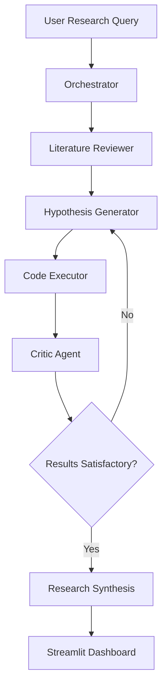

# Agent Workflow

## 1. Workflow Overview

The system uses a coordinated multi-agent workflow to automate scientific discovery.

## 2. Workflow Stages

### Stage 1: Research Query
The user provides a scientific research question or topic.

### Stage 2: Literature Review
The Literature Reviewer Agent:
- Searches arXiv and PubMed.
- Collects relevant scientific papers.
- Extracts important research information.
- Identifies research gaps and existing findings.

### Stage 3: Hypothesis Generation
The Hypothesis Generator Agent:
- Analyses the literature findings.
- Identifies possible research gaps.
- Generates testable hypotheses.
- Provides reasoning and expected outcomes.

### Stage 4: Experiment Execution
The Code Executor Agent:
- Receives an approved hypothesis.
- Develops experiment code.
- Executes code inside a Docker sandbox.
- Collects outputs, errors, and execution logs.

### Stage 5: Critical Evaluation
The Critic Agent:
- Examines experiment results.
- Evaluates statistical significance where appropriate.
- Checks whether results support the hypothesis.
- Recommends further experiments when necessary.

### Stage 6: Research Synthesis
The Research Synthesis Module:
- Combines literature findings and experimental results.
- Generates research summaries.
- Produces a structured scientific report.

### Stage 7: Dashboard
The Streamlit dashboard displays:
- Research query.
- Retrieved literature.
- Generated hypotheses.
- Experiment execution status.
- Evaluation results.
- Final research report.

## 3. Workflow Diagram

## 4. Shared State

Agents communicate through a shared workflow state managed by the orchestration layer.

The state may contain:
- Research query.
- Retrieved papers.
- Extracted findings.
- Generated hypotheses.
- Selected hypothesis.
- Experiment code.
- Execution results.
- Evaluation feedback.
- Final report.
- Workflow status.

## 5. Error Handling and Feedback

If experiment execution fails:
- Capture the error message.
- Send relevant feedback to the experiment development process.
- Allow a controlled correction and retry.
- Record each attempt for reproducibility.

The initial implementation will use an error-feedback mechanism. A reward-based learning approach can be added as a later enhancement if required.
